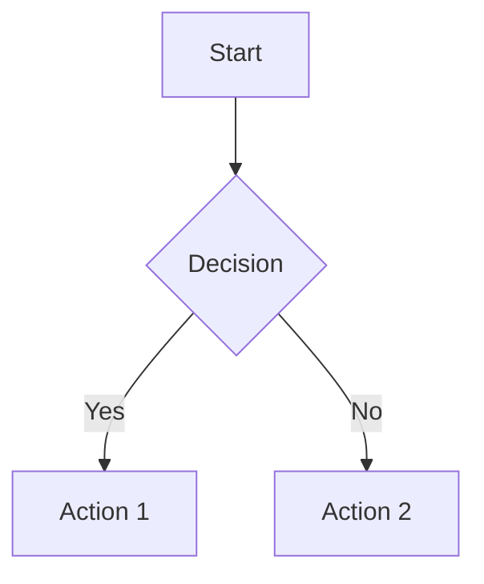
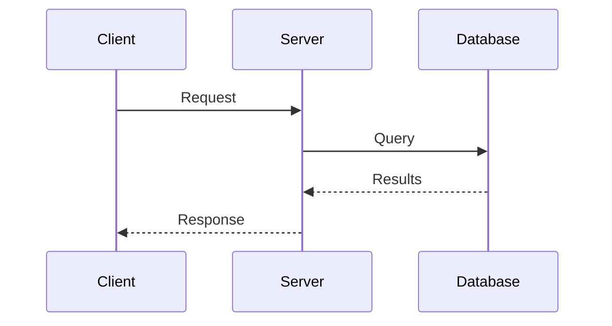
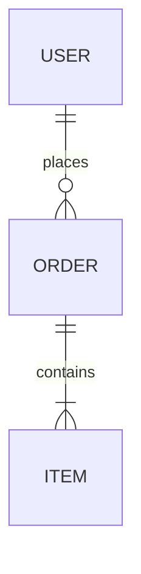
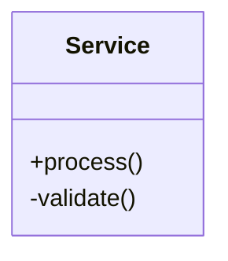

# Repository Review

## Activation

**This skill requires explicit invocation.** Only use this skill when the user specifically asks to use it with phrases like:
- "use repo-review"
- "review this repo"
- "review this repository"
- "/repo-review"
- "use the repo-review skill"

Do NOT auto-activate this skill based on context.

---

## Purpose

This skill helps you analyze and document a codebase by producing a comprehensive markdown summary. The output includes architecture overview, data flow analysis, visual diagrams, and a quickstart guide to help anyone understand the project quickly.

## Review Process

### 1. Discover the Repository Structure

Start by exploring the codebase:

```bash
# Find all directories (excluding common non-essential folders)
find . -type d -not -path '*/node_modules/*' -not -path '*/.git/*' -not -path '*/vendor/*' -not -path '*/__pycache__/*' -not -path '*/dist/*' -not -path '*/build/*' | head -50

# Look for entry points and config files
ls -la
cat package.json 2>/dev/null || cat Cargo.toml 2>/dev/null || cat go.mod 2>/dev/null || cat pyproject.toml 2>/dev/null || cat setup.py 2>/dev/null || cat pom.xml 2>/dev/null || cat Makefile 2>/dev/null

# Find README files
find . -name "README*" -not -path '*/node_modules/*' | head -5

# Identify main source directories
ls src/ 2>/dev/null || ls lib/ 2>/dev/null || ls app/ 2>/dev/null
```

### 2. Identify Key Components

Look for:
- **Entry points**: `main.ts`, `index.js`, `app.py`, `main.go`, `Main.java`, etc.
- **Configuration**: `.env`, `config/`, settings files
- **Models/Types**: Data structures, schemas, database models
- **Routes/Controllers**: API endpoints, request handlers
- **Services/Business Logic**: Core functionality
- **Utilities**: Shared helpers and utilities
- **Tests**: Test files and test structure

### 3. Analyze Data Flow

Trace how data moves through the application:
- Where does data enter the system? (APIs, CLI, files, events)
- How is data transformed or processed?
- Where is data stored? (databases, files, cache)
- How does data exit the system? (responses, exports, side effects)

### 4. Check for Multiple Repositories

If the directory contains multiple independent projects:
```bash
# Look for multiple package files or git repos
find . -maxdepth 2 -name "package.json" -o -name ".git" -o -name "Cargo.toml" -o -name "go.mod" | head -20
```

If multiple repos exist, analyze each separately and organize the output into distinct sections.

### 5. Create the Summary Document

Write a markdown file named `REPO-SUMMARY.md` in the current working directory with this structure:

```markdown
# Repository Summary: [Project Name]

> Generated on [Date]

## 🚀 Quickstart

### What is this?
[One paragraph explaining what this project does and its purpose]

### Key Technologies
- [Language/Framework 1]
- [Language/Framework 2]
- [Database/Storage if applicable]

### Getting Started
\`\`\`bash
# Installation
[installation command]

# Run
[run command]
\`\`\`

---

## 📁 Project Structure

\`\`\`
project-root/
├── src/                # [Description]
│   ├── components/     # [Description]
│   ├── services/       # [Description]
│   └── utils/          # [Description]
├── config/             # [Description]
└── tests/              # [Description]
\`\`\`

---

## 🎯 What Does This Code Do?

### Overview
[Detailed explanation of the project's purpose and functionality]

### Core Features
1. **[Feature 1]**: [Description]
2. **[Feature 2]**: [Description]
3. **[Feature 3]**: [Description]

### Key Files
| File | Purpose |
|------|---------|
| `src/index.ts` | Application entry point |
| `src/routes/` | API route definitions |
| ... | ... |

---

## 🔄 Data Flow

### High-Level Flow
[Explain the overall data flow in words]

### Data Flow Diagram

\`\`\`mermaid
flowchart LR
    A[Input Source] --> B[Processing Layer]
    B --> C[Business Logic]
    C --> D[Data Store]
    D --> E[Output/Response]
\`\`\`

### Detailed Flow

#### 1. Data Input
[How data enters the system]

#### 2. Processing
[How data is validated, transformed, parsed]

#### 3. Business Logic
[Core operations performed on the data]

#### 4. Storage
[How and where data is persisted]

#### 5. Output
[How results are returned or side effects occur]

---

## 🏗️ Architecture

### Architecture Diagram

\`\`\`mermaid
graph TB
    subgraph "Frontend"
        UI[User Interface]
    end
    
    subgraph "Backend"
        API[API Layer]
        SVC[Services]
        DB[(Database)]
    end
    
    UI --> API
    API --> SVC
    SVC --> DB
\`\`\`

### Component Relationships

\`\`\`mermaid
classDiagram
    class Component1 {
        +method1()
        +method2()
    }
    class Component2 {
        +methodA()
    }
    Component1 --> Component2
\`\`\`

---

## 📦 Dependencies

### Main Dependencies
| Package | Version | Purpose |
|---------|---------|---------|
| [package] | [version] | [what it's used for] |

### Dev Dependencies
| Package | Version | Purpose |
|---------|---------|---------|
| [package] | [version] | [what it's used for] |

---

## 🔧 Configuration

### Environment Variables
| Variable | Description | Required |
|----------|-------------|----------|
| `DATABASE_URL` | Database connection string | Yes |
| ... | ... | ... |

### Config Files
- `[config file]`: [purpose]

---

## 📝 Additional Notes

### Assumptions Made
- [Any assumptions about the codebase]

### Areas for Further Investigation
- [Parts of the code that need deeper analysis]

### Potential Improvements
- [Observations about code quality or architecture]
```

---

## Multi-Repository Format

If the directory contains multiple repositories, use this structure:

```markdown
# Repository Summary: [Parent Directory Name]

> Generated on [Date]

## Overview

This directory contains [N] separate projects:

| Project | Description | Primary Language |
|---------|-------------|------------------|
| [project-1/] | [Brief description] | [Language] |
| [project-2/] | [Brief description] | [Language] |

---

# Project 1: [Name]

[Full analysis using the single-repo template above]

---

# Project 2: [Name]

[Full analysis using the single-repo template above]

---

## Cross-Project Relationships

[If the projects interact or share code, explain how]

\`\`\`mermaid
flowchart LR
    P1[Project 1] -->|API calls| P2[Project 2]
    P2 -->|Events| P3[Project 3]
\`\`\`
```

---

## Diagram Guidelines

Use **Mermaid** syntax for diagrams. Common diagram types:

### Flowcharts (for processes and data flow)


### Sequence Diagrams (for interactions)


### Entity Relationship (for data models)


### Class Diagrams (for code structure)


---

## Guidelines

- **Be thorough** — Read key files to understand actual functionality, don't just guess from names
- **Be accurate** — Verify your understanding by reading the code
- **Be visual** — Include diagrams for complex relationships
- **Be practical** — The quickstart should actually work
- **Be organized** — Use clear headings and tables
- **Stay focused** — Prioritize the most important aspects of the codebase
- **Acknowledge unknowns** — Note areas that need clarification or deeper analysis

## After Creating the Document

Present a brief summary to the user:
1. Highlight the most important findings
2. Note any areas of concern or interest
3. Ask if they want to dive deeper into any specific component
